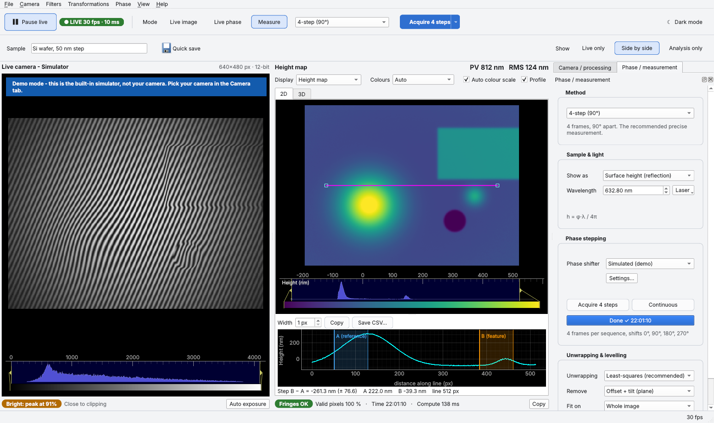
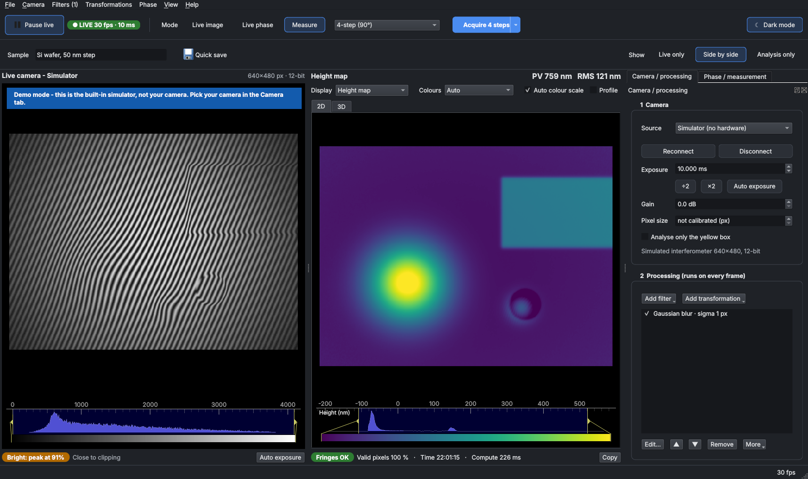
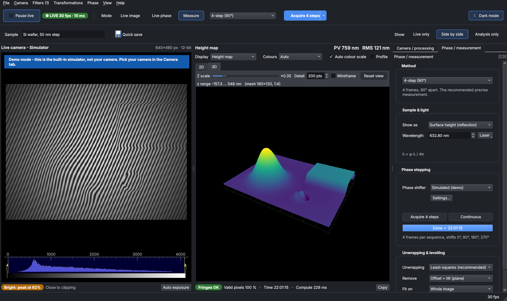

# PhaseScope

A Python desktop app for live microscope and interferometer imaging. In one window it:

1. **Captures images continuously** from a camera and shows them in a fixed *Live camera* area.
2. **Processes the images** through three pop-up menus:
   - **a. Filters:** smoothing, denoising, sharpening and edges, contrast, Fourier band filters, background and flat-field correction, temporal averaging.
   - **b. Transformations:** flip, rotate, transpose, translate, scale, binning, crop and Fourier spectrum.
   - **c. Phase:** phase stepping (3-step, 4-step, 5-step Hariharan, Carré, N-step least squares) and the single-frame Fourier-transform method. It also covers phase unwrapping (Itoh, least-squares DCT, weighted least-squares, quality-guided), background removal, and conversion to height, thickness or refractive-index change.
3. **Visualises the results in 2D and 3D:** a zoomable colour-mapped image with histogram and line profile, and an interactive 3D surface you can rotate.

### Light mode: a 4-step measurement with the step-height profile


### Dark mode: the same measurement with a filter in the processing list


### The height map as a 3D surface you can rotate


*The screenshots use the built-in simulated interferometer. Live fringes are on the left and the height map is on the right. Switch between light and dark with **Dark mode** at the top right (Ctrl+Shift+D); the choice is remembered.*

---

## Installation

Use Python 3.9 or newer. On Windows, run:

```bat
python -m venv .venv
.venv\Scripts\activate
pip install -r requirements.txt
```

### Thorlabs scientific cameras (Zelux, Kiralux, Quantalux, CS-series)

1. Install **ThorCam**, which includes the *Scientific Camera Interfaces* SDK.
2. Install the Python SDK wheel that ships with it. The path is usually:
   ```bat
   pip install "C:\Program Files\Thorlabs\Scientific Imaging\Scientific Camera Support\Scientific Camera Interfaces\SDK\Python Toolkit\thorlabs_tsi_camera_python_sdk_package.zip"
   ```
3. Tell PhaseScope where the native DLLs are. They are usually in `...\Scientific Camera Interfaces\SDK\Native Toolkit\dlls\Native_64_lib`:
   ```bat
   set THORLABS_TSI_DLL_DIR=C:\...\Native Toolkit\dlls\Native_64_lib
   ```
4. **Close ThorCam** before you start PhaseScope. Only one program can open the camera at a time.
5. Check that the camera is detected: `python -m phasescope --list-thorlabs`.

Other cameras, such as USB or DirectShow cameras (including Thorlabs DCx models that appear as DirectShow devices), work through the **OpenCV** source.

## Running

```bat
python -m phasescope                          :: the camera you used last time (the simulator on first start)
python -m phasescope --source thorlabs        :: first Thorlabs camera found
python -m phasescope --source thorlabs --device 12345
python -m phasescope --source opencv --device 0
python -m phasescope --no-gl                  :: compatible 3D view if OpenGL is unavailable
python -m phasescope --no-settings            :: fresh start, ignore remembered settings
```

You can also run `python run_phasescope.py`, or run `pip install .` and then `phasescope`.

## Using the window

### The three modes

The toolbar is split into a few groups with room between them. The top row has the camera (*Start / Pause live* and its status badge), the **Mode** buttons with the method box, the blue **main button**, and **Dark mode** on the right. The second row has the sample name and *Quick save*, and on the right what to **Show** (*Live only*, *Side by side*, *Analysis only*).

The three mode buttons choose what you want to see. Each has a key:

| Mode | Key | What you get |
|---|---|---|
| **Live image** | F2 | The (processed) camera image, no phase. |
| **Live phase** | F3 | A height (or thickness, or Δn) map from every frame, using the Fourier-transform method. Tilt the reference mirror until you see straight fringes 5–20 px apart. The **Fringes** badge under the map says whether they are good. |
| **Measure** | F4 | A precise phase-stepping measurement (3-step, 4-step, 5-step, Carré or N-step; pick one in the box next to *Measure*). |

The bold button next to the modes always does the next sensible thing:

- **Measure (4-step)** while in Live image.
- **Hold / Resume live** in Live phase. Hold freezes the map so you can measure or save it.
- **Acquire 4 steps** with a piezo or the simulator.
- **Capture step 2/4** with manual stepping.
- **Cancel** while a sequence is recording.

### Screen areas

| Area | What it does |
|---|---|
| **Live camera** (left) | Continuous frames. The status badge on the toolbar shows *LIVE 30 fps*, *Paused*, *Recording* or *No frames*. By default the image is shown at **true brightness**: a dark exposure looks dark. Clipped pixels are painted red. The **exposure meter** below the image says *Too dark*, *Exposure OK* or *Too bright* and suggests a value. **Auto** (Ctrl+E) sets the exposure for you. Tick *Analyse only the yellow box* (Camera tab) to process just one region. |
| **Analysis** (right) | *Display* chooses the map: height (or thickness / Δn), processed image, raw camera, wrapped or unwrapped phase, or fringe contrast. The 2D and 3D tabs switch views. **PV** and **RMS** are shown large at the top. The line under the map lists the other numbers; hover over it for explanations. If you change settings, the previous map is kept and marked *Earlier result*. |
| **Camera / processing** tab | 1 – camera source, *Detect*, *Connect*, exposure (÷2, ×2, Auto), gain and **pixel size** (µm per pixel, which gives the line profile real distances). 2 – the processing steps that run on every frame: untick a step to compare, double-click to edit, *More → Bypass all* (Ctrl+B). Filters that would spoil phase results are marked ⚠ while a phase mode is on. |
| **Phase / measurement** tab | It only shows what the chosen method needs: the sample and light settings (wavelength presets, refractive indices or thickness, with the formula); the phase-stepping or live-phase controls; unwrapping and levelling; and *Advanced settings* (collapsed). |

The **Filters**, **Transformations** and **Phase** pop-up menus are in the menu bar (Filters shows how many are switched on, e.g. *Filters (1)*). They also appear when you **right-click an image or the 3D view**, and *Add filter* / *Add transformation* are in the Camera / processing tab. When you pick a filter, a dialog with sliders opens and the image updates live while you drag. *Add step* keeps the filter and *Cancel* removes it.

**Enlarge a view:** double-click an image, or use *Live only / Side by side / Analysis only* (Alt+1/2/3). Esc returns. F9 hides the side panels and F11 switches to full screen. **F1** lists every keyboard shortcut.

**Dark mode:** press *Dark mode* at the top right of the toolbar, choose *View → Dark mode*, or press Ctrl+Shift+D. The whole window switches to dark colours (the image areas are dark in both modes) and PhaseScope remembers the choice for the next start.

### Measuring a step height

1. Tick **Profile** above the map (or press L) and drag the magenta line across the step.
2. Move the blue **A** (reference) and orange **B** (feature) bands in the profile plot onto the two levels. The readout shows *Step B − A* with its uncertainty.
3. Width averages several parallel lines. *Copy* and *Save CSV…* export the profile.

**Level on the substrate.** When a film covers a large part of the image, fitting the background on the whole image tilts the result and the step reads low. To avoid this, set *Phase tab → Unwrapping & levelling → Fit on* to **Flat reference area**. Then drag the green box onto bare substrate, or right-click the map and choose *Use the visible area as flat reference*.

### Phase measurement workflows

- **Live, single frame (Fourier transform):** press **Live phase** (F3). *Lock fringe frequency* steadies the map, and *Hold* freezes it. The camera view keeps its full frame rate: the phase is computed in the background, and the status bar shows both rates.
- **Phase stepping with a piezo:** in the Phase tab, choose *Serial piezo controller* as phase shifter. Set the port, command, *volts per 2π* and offset in *Settings…*, then press *Connect*. The defaults use the `xvoltage=` command of the Thorlabs MDT693B and MDT694B controllers. If the port is wrong, the error dialog lists the ports it found. *Acquire* records one sequence. *Continuous* repeats sequences to give a live map at frame rate ÷ N.
- **Manual phase stepping:** choose the *Manual* shifter. The live image tells you which phase (and mirror displacement) to set next. Press **Space** for each step. The capture waits for the settle time and averages *Frames per step* new frames. *Undo last step* (Ctrl+Z) removes a bad step.
- **Calibrating the piezo:** record a sequence with the **Carré** method. It reports the *measured step*. Adjust *volts per 2π* until it reads 90°.
- **Offline:** *File → Open image(s)…* loads one image (analysed like a live frame) or N images (treated as an N-step sequence).

### Phase to physical units

| Output | Formula | Use |
|---|---|---|
| Surface height (reflection) | h = φ λ / 4π | Topography of reflective samples |
| Thickness (transmission) | t = φ λ / (2π (n_sample − n_medium)) | Transparent films or cells with known refractive indices |
| Refractive-index change | Δn = φ λ / (2π t) | Refraction measurements with a known thickness |
| Optical path difference | OPD = φ λ / 2π | Generic |

Pixels whose fringe contrast is below *Min. fringe contrast* (Advanced) are left blank. *Remove* subtracts the offset, the tilt (plane) or the tilt plus curvature.

### Saving

- **Quick save (Ctrl+S)** writes one set of files without asking:
  - the raw frame (16-bit TIFF)
  - the map (32-bit TIFF)
  - all maps plus metadata (`.npz`)
  - a picture of the current view (PNG)
  - a readable `_info.txt` with camera, settings, processing steps and results

  The files go to `Documents/PhaseScope data/<date>/` (or *File → Choose save folder…*), named `<date_time>_<sample>_<method>`. Type the sample name in the toolbar.
- **Save measurement as…** (Ctrl+Shift+S) writes the same set under a name and folder you choose. The single-file save commands are still in the *File* menu.

PhaseScope remembers your camera, exposure, wavelength and refractive indices, piezo settings, pixel size, save folder, window layout and light or dark mode between sessions. *Help → Reset all settings…* forgets them. Processing steps are not restored, so every session starts with clean images.

## Code layout

```
phasescope/
  camera.py       camera sources (simulator, OpenCV, Thorlabs TSI) and phase shifters
  processing.py   filters, transformations, thread-safe processing pipeline
  phase.py        phase stepping, Fourier method, unwrapping, detrending, unit conversion
  acquisition.py  background acquisition thread (live frames and phase-step sequences)
  widgets.py      2D image panel (overlays, profile tool), 3D surface panel, parameter dialog, status pills
  theme.py        light and dark colour themes (Fusion style, palette and spacing)
  gui.py          main window, menus, docks
tests/            pytest suite (algorithms are checked against known phase maps)
```

To add a filter, write one decorated function in `processing.py`. The menus and the parameter dialog are generated from it:

```python
@register("my_filter", "My filter", "filter", group="Smoothing",
          params=(Param("strength", "Strength", "float", 1.0, 0.0, 10.0),))
def my_filter(img, state, strength):
    return img * strength
```

To support another camera, subclass `CameraSource` in `camera.py` and implement `grab()`.

## Tests

```bash
pip install pytest
python -m pytest
```
