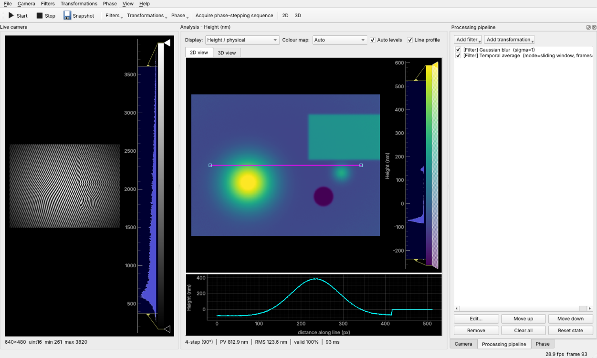

# PhaseScope

A Python desktop app for live microscope and interferometer imaging. In one window it:

1. **Captures images continuously** from a camera and shows them in a fixed *Live camera* area.
2. **Processes the images** through three pop-up menus:
   - **a. Filters:** smoothing, denoising, sharpening and edges, contrast, Fourier band filters, background and flat-field correction, temporal averaging.
   - **b. Transformations:** flip, rotate, transpose, translate, scale, binning, crop and Fourier spectrum.
   - **c. Phase:** phase stepping (3-step, 4-step, 5-step Hariharan, Carré, N-step least squares) and the single-frame Fourier-transform method. It also covers phase unwrapping (Itoh, least-squares DCT, weighted least-squares, quality-guided), background removal, and conversion to height, thickness or refractive-index change.
3. **Visualises the results in 2D and 3D:** a zoomable colour-mapped image with histogram and line profile, and an interactive 3D surface you can rotate.




*The screenshots use the built-in simulated interferometer. Live fringes are on the left. The height map from a 4-step measurement is on the right, shown with a line profile (top) and as a 3D surface (bottom).*

---

## Installation

Use Python 3.9 or newer. On Windows, run:

```bat
python -m venv .venv
.venv\Scripts\activate
pip install -r requirements.txt
```

### Thorlabs scientific cameras (Zelux, Kiralux, Quantalux, CS-series)

1. Install **ThorCam**, which includes the *Scientific Camera Interfaces* SDK.
2. Install the Python SDK wheel that ships with it. The path is usually:
   ```bat
   pip install "C:\Program Files\Thorlabs\Scientific Imaging\Scientific Camera Support\Scientific Camera Interfaces\SDK\Python Toolkit\thorlabs_tsi_camera_python_sdk_package.zip"
   ```
3. Tell PhaseScope where the native DLLs are. They are usually in `...\Scientific Camera Interfaces\SDK\Native Toolkit\dlls\Native_64_lib`:
   ```bat
   set THORLABS_TSI_DLL_DIR=C:\...\Native Toolkit\dlls\Native_64_lib
   ```
4. **Close ThorCam** before you start PhaseScope. Only one program can open the camera at a time.
5. Check that the camera is detected: `python -m phasescope --list-thorlabs`.

Other cameras, such as USB or DirectShow cameras (including Thorlabs DCx models that appear as DirectShow devices), work through the **OpenCV** source.

## Running

```bat
python -m phasescope                          :: simulated interferometer, no hardware needed
python -m phasescope --source thorlabs        :: first Thorlabs camera found
python -m phasescope --source thorlabs --device 12345
python -m phasescope --source opencv --device 0
python -m phasescope --no-gl                  :: matplotlib 3D view if OpenGL is unavailable
```

You can also run `python run_phasescope.py`, or run `pip install .` and then `phasescope`.

## Using the window

| Area | What it does |
|---|---|
| **Live camera** (left) | Continuous raw frames, with a histogram for setting exposure. Saturated pixels are reported in red. Tick *Analyse only the yellow ROI* in the Camera panel to process just one region. |
| **Analysis** (centre) | Shows the *processed image*, *wrapped/unwrapped phase*, *height/physical* map or *modulation*. Switch between the **2D view** and **3D view** tabs. Use *Line profile* for cross-sections, and right-click for the pop-up menus. |
| **Camera** panel | Source, connect/disconnect, exposure, gain and ROI. |
| **Processing pipeline** panel | The filters and transformations you added. They run top to bottom on every frame. Untick a step to bypass it, double-click to edit it, or reorder and remove steps. A step that fails is shown in red and bypassed, so the live view keeps running. |
| **Phase** panel | Method, phase shifter, acquisition timing, Fourier-method settings, unwrapping, background removal and output units. |

The **Filters**, **Transformations** and **Phase** pop-up menus are on the toolbar and in the menu bar. They also appear when you **right-click an image or the 3D view**. When you pick a filter, a dialog opens and its parameters apply live while you adjust them.

### Phase measurement workflows

- **Live, single frame (Fourier transform):** tilt the reference mirror until you see straight carrier fringes, roughly 5–20 px per fringe. Then choose *Phase → Fourier transform*. Every frame becomes a phase or height map, which lets you watch a sample change in real time. *Lock current carrier* steadies the result.
- **Phase stepping with a piezo:** choose a stepping method and the *Serial piezo controller* shifter, then set the port, command, *volts per 2π* and offset in *Phase → Piezo controller settings…*. The defaults use the `xvoltage=` command of the Thorlabs MDT693B and MDT694B controllers. *Acquire* records one sequence. *Continuous* repeats sequences to give a live phase map at frame rate ÷ N.
- **Manual phase stepping:** choose the *Manual* shifter. The Phase panel tells you which phase (and mirror displacement) to set next. Press *Capture step* (or **Space**) for each step.
- **Calibrating the piezo:** record a sequence with the **Carré** algorithm. It reports the *measured step*. Adjust *volts per 2π* until it reads 90°.
- **Offline:** *File → Open image(s)…* loads one image (analysed like a live frame) or N images (treated as an N-step sequence).

### Phase to physical units

| Output | Formula | Use |
|---|---|---|
| Surface height (reflection) | h = φ λ / 4π | Topography of reflective samples |
| Thickness (transmission) | t = φ λ / (2π (n_sample − n_medium)) | Transparent films or cells with known refractive indices |
| Refractive-index change | Δn = φ λ / (2π t) | Refraction measurements with a known thickness |
| Optical path difference | OPD = φ λ / 2π | Generic |

Pixels whose fringe modulation is below the *modulation threshold* are masked. *Background removal* subtracts the piston, the tilt (plane) or the tilt plus curvature.

### Saving

*File* lets you save the raw frame (16-bit TIFF, PNG or NumPy), the processed image (32-bit TIFF, NumPy or CSV), and the phase result. A phase result can be saved as `.npz` with every map plus metadata, or as the height map in TIFF, CSV or PNG. You can also save either view as a PNG.

## Code layout

```
phasescope/
  camera.py       camera sources (simulator, OpenCV, Thorlabs TSI) and phase shifters
  processing.py   filters, transformations, thread-safe processing pipeline
  phase.py        phase stepping, Fourier method, unwrapping, detrending, unit conversion
  acquisition.py  background acquisition thread (live frames and phase-step sequences)
  widgets.py      2D image panel, 3D surface panel, parameter dialog
  gui.py          main window, menus, docks
tests/            pytest suite (algorithms are checked against known phase maps)
```

To add a filter, write one decorated function in `processing.py`. The menus and the parameter dialog are generated from it:

```python
@register("my_filter", "My filter", "filter", group="Smoothing",
          params=(Param("strength", "Strength", "float", 1.0, 0.0, 10.0),))
def my_filter(img, state, strength):
    return img * strength
```

To support another camera, subclass `CameraSource` in `camera.py` and implement `grab()`.

## Tests

```bash
pip install pytest
python -m pytest
```
